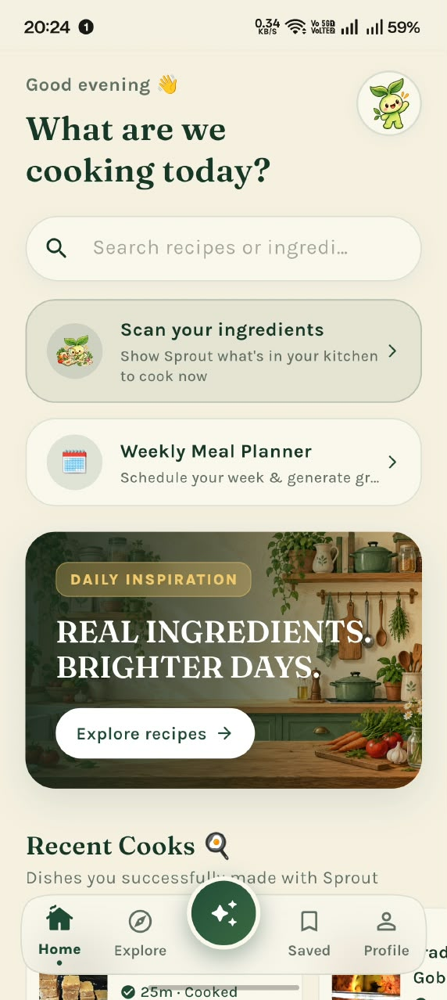
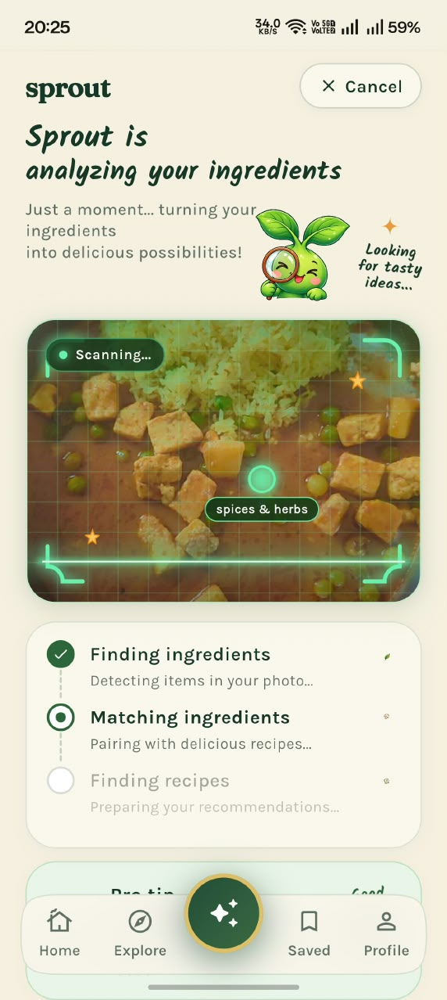
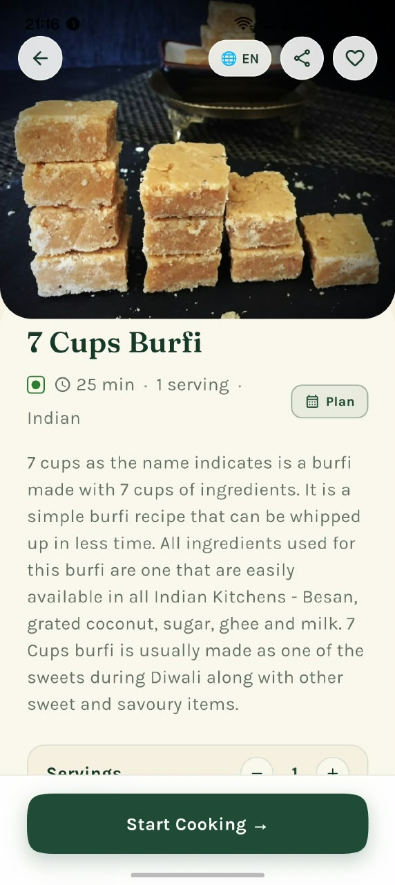
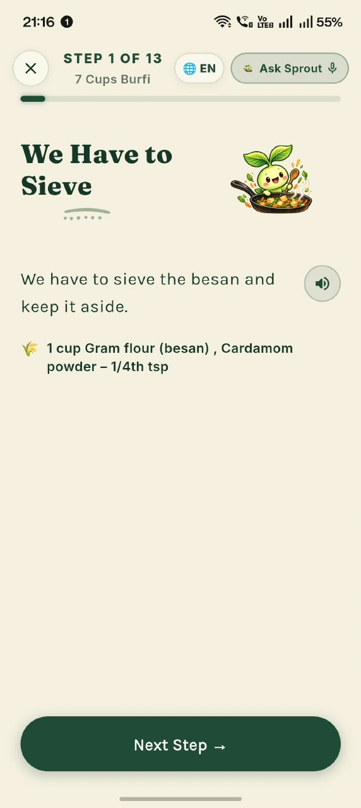
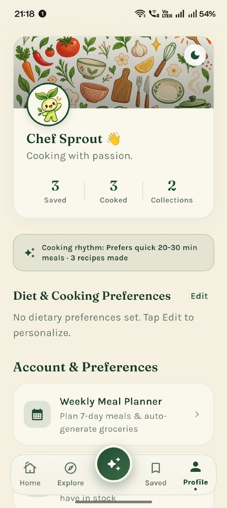

<p align="center">
  
</p>

<h1 align="center">🌱 Sprout — AI Recipe & Smart Kitchen Companion</h1>

<p align="center">
  <b>Cook smarter, eat healthier, and minimize food waste with multimodal AI vision, voice-guided cooking, and intelligent pantry matching.</b>
</p>

<p align="center">
  <a href="https://flutter.dev"></a>
  <a href="https://dart.dev"></a>
  <a href="https://supabase.com"></a>
  <a href="https://groq.com"></a>
  <a href="https://ai.google.dev"></a>
  <a href="LICENSE"></a>
  <a href="https://github.com/Krishh19/Sprout-Recipe-app/actions"></a>
</p>

---

## 📖 Table of Contents

- [About Sprout](#-about-sprout)
- [Key Features](#-key-features)
- [App Showcase](#-app-showcase)
- [Architecture & Tech Stack](#-architecture--tech-stack)
- [Project Structure](#-project-structure)
- [Getting Started](#-getting-started)
- [Supabase Edge Functions Backend](#-supabase-edge-functions-backend)
- [Testing & Quality Assurance](#-testing--quality-assurance)
- [Security Model](#-security-model)
- [Contributing](#-contributing)
- [License](#-license)

---

## 🌿 About Sprout

**Sprout** is an intelligent Flutter culinary companion designed to turn whatever you have in your fridge or pantry into delicious, nutritious meals. 

By pairing **multimodal computer vision** (Google Gemini) with **ultra-fast language inference** (Groq Qwen 27B) and a **cloud-synced pantry database** (Supabase), Sprout eliminates mealtime indecision, tracks real-time nutrition, and coaches you step-by-step through every recipe completely hands-free.

---

## ✨ Key Features

### 📸 Multimodal AI Ingredient & Barcode Scanner
- **Live Vision Scanning**: Point your camera at loose vegetables, spices, or produce. Gemini multimodal vision instantly identifies ingredients and tags them with confidence scores.
- **Packaged Food Barcodes**: Built-in barcode scanner integrated with **Open Food Facts API** to fetch certified nutritional facts, brand details, and allergen warnings in real-time.
- **Quick-Add Ingredient Tray**: One-tap bubbles to easily add staple ingredients (`Tomato`, `Potato`, `Coriander`, `Cream`) to your active scan.

### ⚡ Ultra-Fast AI Culinary Intelligence (Groq Qwen 27B)
- **Smart Substitutions**: Out of butter, buttermilk, or eggs? Get context-aware, culinary-accurate substitutions with custom baking/cooking ratios in milliseconds.
- **Instant Multilingual Translation**: Translate entire ingredient lists and cooking instructions into Hindi, Spanish, French, and regional languages without lag.
- **Nutrition Decomposition**: Instant calculation of calories, protein, carbs, fats, fiber, and micronutrients tailored to your exact serving sizes.

### 🍳 Hands-Free Voice-Guided Cooking Mode
- **Step-by-Step Focus**: Clean, high-contrast, distraction-free cards highlighting the current instruction.
- **Voice Control & Audio Feedback**: Integrated Speech-to-Text (STT) for hands-free navigation ("Next", "Back", "Repeat") and custom Text-to-Speech (TTS) reading steps aloud so you never have to touch your phone with messy hands.
- **Independent Step Timers**: Built-in audio countdown timers synced directly to individual recipe steps with soothing completion chimes.

### 🧺 Smart Pantry & Meal Intelligence
- **Pantry Matching**: Automatically categorizes what you already own vs. what ingredients you're missing for any recipe.
- **One-Tap Shopping List**: Add missing recipe ingredients straight into your interactive shopping list with checklist toggles and item sorting.
- **Collections & Bookmarking**: Organize recipes into custom collections (e.g. *Quick 15-Min Dinners*, *High Protein Lunches*).

### 🎨 Artisan Glassmorphic UI & Mascot System
- **Chef Sprout Mascot**: Contextual mascot reactions that cheer you on, celebrate completed meals, and guide newcomers.
- **Glassmorphism Navigation**: Floating frosted-glass bottom navigation bar with fluid animations.
- **Dynamic Theming**: First-class support for both Light and Dark modes with soft pastel accents and WCAG AA accessible contrast.

---

## 📱 App Showcase

| 🏠 Home & Feed | 📸 AI Vision Scanner | 🥗 Recipe & Nutrition |
| :---: | :---: | :---: |
|  |  |  |

<br/>

| 🍳 Voice Cooking Mode | 👨‍🍳 Chef Sprout Profile |
| :---: | :---: |
|  |  |

> *Note: Place your screenshots in the [`screenshots/`](screenshots/) directory to render the previews on GitHub.*

---

## 🛠️ Architecture & Tech Stack

```
                        ┌──────────────────────────────────────┐
                        │             Flutter App              │
                        │ (Riverpod State + Glassmorphic UI)   │
                        └──────────────────┬───────────────────┘
                                           │
                        ┌──────────────────┴───────────────────┐
                        │        Supabase Edge Function        │
                        │           (sprout-ai / Deno)         │
                        └───────┬──────────────────────┬───────┘
                                │                      │
                 ┌──────────────▼──────────┐   ┌───────▼─────────────┐
                 │    Groq Fast Cloud      │   │  Google Gemini AI   │
                 │   (Qwen 27B LLM Engine) │   │ (Multimodal Vision) │
                 └─────────────────────────┘   └─────────────────────┘
```

| Layer | Technologies |
| :--- | :--- |
| **Frontend Framework** | [Flutter 3.13+](https://flutter.dev) (Dart 3.13+) |
| **State Management** | [flutter_riverpod 3.4+](https://riverpod.dev) |
| **Backend & Database** | [Supabase](https://supabase.com) (PostgreSQL, Row Level Security, Edge Functions) |
| **Fast AI Inference** | [Groq Cloud](https://groq.com) (`qwen/qwen3.8-27b`) for nutrition, substitution, and translation |
| **Vision AI** | [Google Gemini 2.5 Flash](https://ai.google.dev) for multimodal image and ingredient recognition |
| **Camera & Barcode** | [mobile_scanner 7.4+](https://pub.dev/packages/mobile_scanner) & [image_picker](https://pub.dev/packages/image_picker) |
| **Speech & Audio** | [speech_to_text](https://pub.dev/packages/speech_to_text), [flutter_tts](https://pub.dev/packages/flutter_tts), [audioplayers](https://pub.dev/packages/audioplayers) |
| **Secure Storage** | [flutter_secure_storage](https://pub.dev/packages/flutter_secure_storage) (Android Keystore / iOS Keychain) |
| **Walkthrough** | [showcaseview](https://pub.dev/packages/showcaseview) for interactive spotlight tours |

---

## 📂 Project Structure

```text
sprout/
├── .github/
│   ├── workflows/ci.yml           # Automated lint, test, and build CI
│   ├── ISSUE_TEMPLATE/            # Bug report & feature request templates
│   └── PULL_REQUEST_TEMPLATE.md   # Standardized PR checklist
├── assets/
│   ├── brand/                     # App icons & brand assets
│   ├── cooking/                   # Cooking mode visual assets
│   ├── empty_scans/               # Empty state illustrations
│   ├── ingredients/               # 38 optimized ingredient icon assets
│   ├── mascot/                    # Chef Sprout mascot expressions
│   ├── onboarding/                # Intro slider illustrations
│   ├── spotlight tour/            # Tutorial coach mark assets
│   └── styling/                   # Decorative stickers & backdrop elements
├── lib/
│   ├── core/                      # Global configuration, routes & tutorial steps
│   ├── design/                    # Design tokens, typography, radii & components
│   ├── features/
│   │   ├── cooking/               # Interactive cooking assistant screen
│   │   ├── home/                  # Home recipe feed & pantry highlights
│   │   ├── onboarding/            # First-run welcome carousel
│   │   ├── planner/               # Meal planning features
│   │   ├── profile/               # Chef Sprout profile, preferences & legal
│   │   ├── recipes/               # Recipe detail, nutrition & substitutions
│   │   ├── saved/                 # Bookmarks & custom collections
│   │   ├── scanner/               # AI Vision & Barcode ingredient scanner
│   │   ├── search/                # Semantic search & category filtering
│   │   └── shopping/              # Smart grocery shopping list
│   ├── models/                    # Data models (Recipe, Pantry, Nutrition, etc.)
│   ├── providers/                 # Riverpod state providers
│   ├── repositories/              # Supabase & Open Food Facts data layer
│   └── services/                  # Voice STT/TTS and AI services
├── screenshots/                   # App screenshots for documentation
├── supabase/
│   └── functions/sprout-ai/       # Secure Edge Function (Groq + Gemini proxy)
└── test/                          # Unit, widget, and integration tests (172 tests)
```

---

## 🚀 Getting Started

### 1. Prerequisites
- [Flutter SDK](https://docs.flutter.dev/get-started/install) (`>= 3.13.0`)
- [Git](https://git-scm.com/)
- Android Studio / Xcode

### 2. Clone the Repository
```bash
git clone https://github.com/Krishh19/Sprout-Recipe-app.git
cd Sprout-Recipe-app
```

### 3. Install Dependencies
```bash
flutter pub get
```

### 4. Configuration
Sprout connects to your Supabase backend. Client keys are safe for public distribution because sensitive inference keys (`GEMINI_API_KEY`, `GROQ_API_KEY`) reside exclusively in your Supabase Edge Function secrets.

You can configure keys via environment flags at compile time:
```bash
flutter run \
  --dart-define=SUPABASE_URL="https://your-project.supabase.co" \
  --dart-define=SUPABASE_ANON_KEY="your-supabase-publishable-key"
```

---

## ⚡ Supabase Edge Functions Backend

Sprout's AI capabilities are powered by the `sprout-ai` Edge Function located in `supabase/functions/sprout-ai/index.ts`.

### Deploying the Edge Function:
```bash
# 1. Login to Supabase CLI
supabase login

# 2. Link your Supabase project
supabase link --project-ref your-project-id

# 3. Set Edge Function Secrets
supabase secrets set GEMINI_API_KEY="your-gemini-key"
supabase secrets set GROQ_API_KEY="your-groq-key"

# 4. Deploy the function
supabase functions deploy sprout-ai
```

---

## 🧪 Testing & Quality Assurance

Sprout maintains 100% test pass rates across 172 unit and widget tests:

```bash
# Run Dart analyzer (ensures 0 lints, 0 warnings)
dart analyze

# Run all test suites
flutter test

# Generate test coverage report
flutter test --coverage
```

### Building the Release APK
To build a standalone production release APK:
```bash
flutter build apk --release
# The APK will be generated at build/app/outputs/flutter-apk/app-release.apk
```

---

## 🔒 Security Model

- **No Secrets in Client Builds**: All Groq and Gemini API keys are processed server-side in Supabase Edge Functions. Client decompilation reveals zero AI secret tokens.
- **Row Level Security (RLS)**: Enforced across all Supabase database tables ensuring users can only read and write their own data.
- **Hardware-Backed Encryption**: On-device tokens and settings are encrypted via `flutter_secure_storage` utilizing Android Keystore and iOS Keychain.

For vulnerability disclosure, please refer to our [Security Policy](SECURITY.md).

---

## 🤝 Contributing

Contributions, bug reports, and feature requests are warmly welcomed! 

1. Review the [Code of Conduct](CODE_OF_CONDUCT.md).
2. Check the [Contributing Guide](CONTRIBUTING.md) for branch and commit conventions.
3. Open a Pull Request or create an issue using our GitHub templates.

---

## 📄 License

This project is licensed under the terms of the [MIT License](LICENSE).

<p align="center">
  Made with ❤️ and passion by <a href="https://github.com/Krishh19"><b>Krish</b></a>.
</p>
